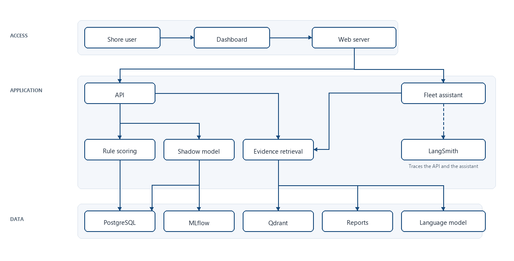

# Ship Detention Early Warning System

Shore staff use this system to see which vessels are most likely to face a detention or a serious deficiency at the next inspection, and to read the records behind that judgement.

## Business overview

Port state control inspections can detain a ship when deficiencies, overdue maintenance, or weak recent performance add up. The cost is delay, off-hire, and follow-up with the flag and class.

The system keeps one view of the fleet. It scores every vessel from the inspection, deficiency, maintenance, equipment, crew, and audit records the operator uploads. High-scoring vessels sit at the top of the watchlist. Opening a vessel shows the drivers of the score, the open issues, and the source records. A fleet assistant answers questions in plain language and cites those records.

Scores and counts come from the database. Narrative answers come from the indexed inspection reports and are limited to the records that were retrieved.

## Capabilities implemented

- Fleet ranking with High, Medium, and Low bands, and a watchlist of the vessels that need attention.
- A rule score from the current operating data, including overrides when a defined condition is met.
- A shadow model (logistic regression) that can be shown beside the rule score. A successful data upload retrains it. The fitted model is stored in MLflow.
- A vessel report with score drivers, inspection history, open issues, and recommended actions. Completed actions are recorded.
- Evidence answers for one vessel, with citations and links to the underlying records. A question about a different vessel is refused.
- A fleet assistant for any vessel or the whole fleet. Follow-up questions stay in the chat, and threads are kept in the database.
- Checks that refuse empty, oversized, or instruction-override questions before they reach the model.
- CSV upload with a change summary. Uploaded reports are indexed for retrieval.
- A validation view that compares the rule score with later inspection outcomes.
- Sign-in with an API key, a health check, and API documentation at `/docs` and `/redoc`.

## High-level solution design

The browser talks only to the web server. The web server serves the dashboard and forwards API, documentation, and chat traffic to the application. The application reads and writes PostgreSQL, retrieves report passages from Qdrant, and calls the configured language model when an answer needs generation.



| Component | Role |
| --- | --- |
| Dashboard | Fleet ranking, vessel report, upload, and validation. React application served by nginx. |
| Web server | Serves the dashboard and proxies `/api`, `/docs`, `/redoc`, and `/chat`. |
| API | FastAPI service. Scoring, upload, records, actions, and evidence. |
| Fleet assistant | Chainlit chat mounted at `/chat`. Same API key as the dashboard. |
| Rule scoring | Deterministic score from `api/rules.yaml` and the tables in PostgreSQL. |
| Shadow model | Second score for comparison. Training runs are recorded in MLflow. |
| Evidence retrieval | Report text is embedded in Qdrant. Answers are generated from the retrieved passages. |
| PostgreSQL | Vessels, inspections, deficiencies, uploads, actions, and chat history. |
| Language model | OpenAI or Gemini, selected with `LLM_PROVIDER`. |
| LangSmith | Optional traces for chat and retrieval. |

## Local setup for developers

### Prerequisites

- Docker Desktop
- For dashboard work without rebuilding the web image: Node.js 20 or later
- For API tests: Python 3.13

### Configure

From `ship-risk`:

```bash
copy .env.example .env
```

On macOS or Linux, use `cp .env.example .env`.

Set these values in `.env`. Do not commit that file.

| Variable | Purpose |
| --- | --- |
| `POSTGRES_PASSWORD` | Password for the `shiprisk` database user. |
| `API_KEY` | Key sent as `X-API-Key`. This is also the dashboard sign-in value. |
| `LLM_PROVIDER` | `openai` or `gemini`. |
| `OPENAI_API_KEY` or `GOOGLE_API_KEY` | Key for the provider selected above. |
| `CHAINLIT_AUTH_SECRET` | Signs the chat session. Use a long random value. |
| `WEB_PORT` | Host port for the dashboard. Default is `8080`. |
| `LANGSMITH_API_KEY` | Optional. Leave empty to run without tracing. |
| `AS_OF` | Optional scoring date (`YYYY-MM-DD`). Empty means today. |

### Start the stack

```bash
docker compose up -d --build
```

Load the sample CSVs once, either from **Data upload** in the dashboard or from the command line:

```bash
docker compose --profile setup run --rm ingest
```

The ingest profile reads `ship-risk/data`, loads it into PostgreSQL, and indexes the generated reports.

### Open the application

| Surface | Address |
| --- | --- |
| Dashboard | `http://localhost:8080` |
| API health | `http://localhost:8080/api/health` |
| API docs | `http://localhost:8080/docs` |
| Fleet assistant | `http://localhost:8080/chat` |
| MLflow | `http://localhost:5000` |

Replace `8080` with the value of `WEB_PORT` when that variable is set. Sign in on the dashboard with any display name and the `API_KEY` value.

PostgreSQL is published on host port `5433` (database `shiprisk`, user `shiprisk`). Qdrant stays on the Docker network.

### Dashboard development

The Vite dev server proxies API and chat traffic to the running stack.

```bash
cd web
npm install
```

Windows PowerShell:

```powershell
$env:API_PROXY="http://localhost:8080"; npm run dev
```

macOS or Linux:

```bash
API_PROXY=http://localhost:8080 npm run dev
```

### API tests

From `ship-risk/api`, with the project virtual environment active:

```bash
pytest
```

Tests that need a database are skipped unless `TEST_DATABASE_URL` is set. Tests that need Qdrant use `QDRANT_TEST_URL` (default `http://localhost:56333`).
